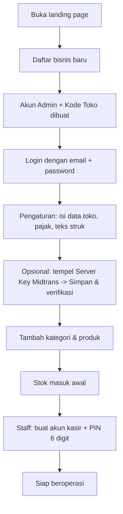
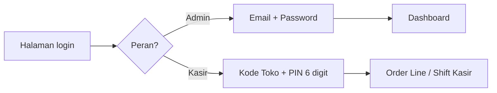
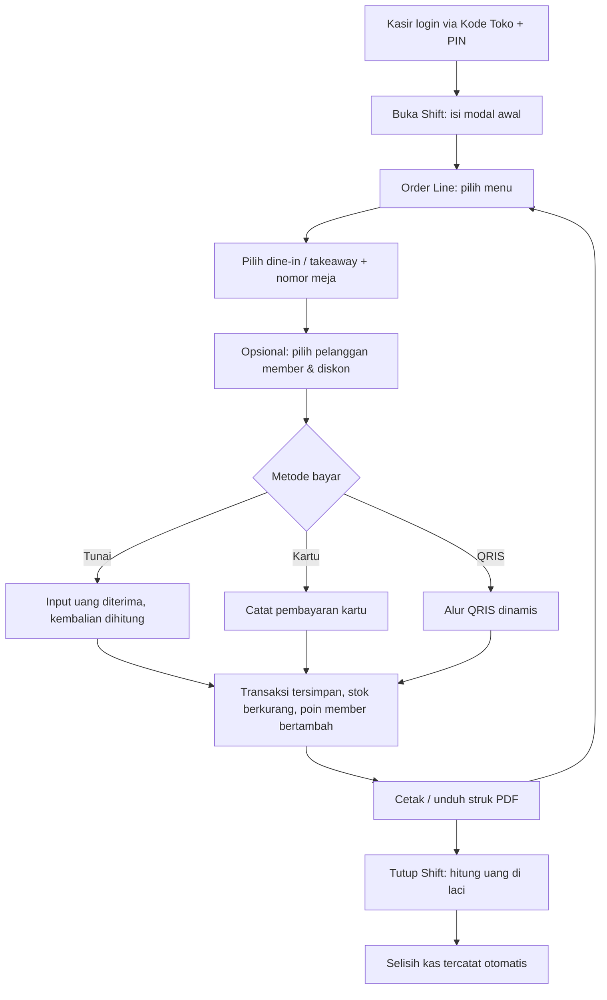
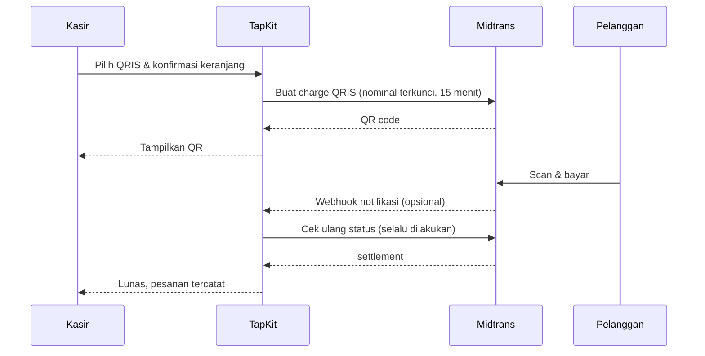
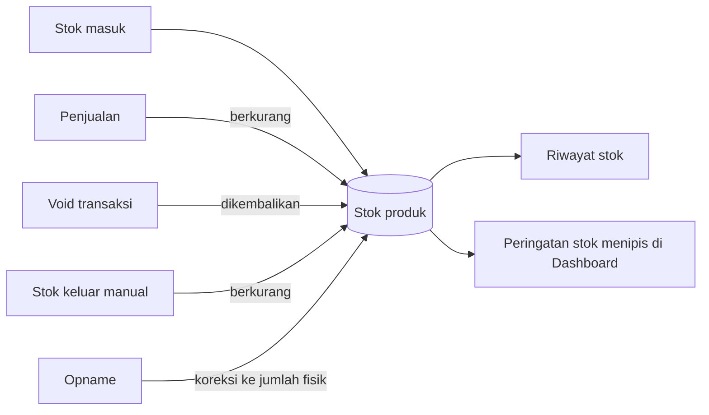
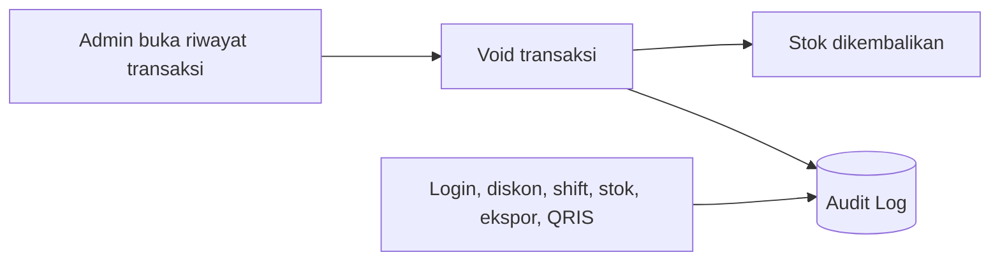
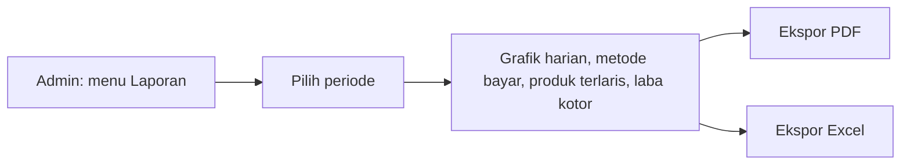

# TapKit POS :)

Aplikasi kasir (Point of Sale) **multi-bisnis** berbasis **Laravel**, dengan manajemen produk, stok, pelanggan loyalty, shift kasir, laporan penjualan, audit log, dan pembayaran **QRIS dinamis (Midtrans)**. Tampilan memakai desain *Luminescent Fintech* (sidebar gelap, aksen lime, mode terang/gelap) dan responsif untuk desktop, tablet, dan mobile.

Repo: <https://github.com/abelfavian21/omahcoding-POS>

---

## Daftar Isi

1. [Akun siap pakai](#akun-siap-pakai)
2. [Fitur lengkap](#fitur-lengkap)
3. [Alur penggunaan (flow)](#alur-penggunaan-flow)
4. [Teknologi](#teknologi)
5. [Instalasi](#instalasi)
6. [Konfigurasi `.env`](#konfigurasi-env)
7. [Peran dan akses](#peran-dan-akses)
8. [QRIS dinamis (Midtrans)](#qris-dinamis-midtrans)
9. [Keamanan](#keamanan)
10. [Struktur proyek](#struktur-proyek)
11. [Desain dan tampilan](#desain-dan-tampilan)
12. [Pemecahan masalah](#pemecahan-masalah)
13. [Pengembangan lanjutan](#pengembangan-lanjutan-ide)
14. [Lisensi](#lisensi)

---

## Akun siap pakai

Gunakan akun berikut untuk langsung mencoba aplikasi (login lewat halaman login di landing page):

| Peran | Email | Password |
|---|---|---|
| Admin | `abel.favian02@gmail.com` | `Abelfavian2026` |

> ⚠️ **Hanya untuk demo/pengembangan.** Karena password tercantum di README yang publik, **jangan** dipakai untuk data bisnis sungguhan. Ganti password (atau hapus akun ini) sebelum aplikasi dipakai di server produksi.

Akun kasir bisa dibuat oleh Admin lewat menu **Staff**, lalu kasir login cepat memakai **Kode Toko + PIN 6 digit**.

---

## Fitur lengkap

### Kasir
- **Order Line**: pilih menu, dine-in / takeaway, nomor meja, pelanggan member, diskon.
- **Metode bayar**: tunai, QRIS, kartu. QRIS dinamis otomatis terkonfirmasi lewat Midtrans.
- **Struk PDF** untuk setiap transaksi.
- **Perintah suara** (bahasa Indonesia) untuk menambah menu dan membayar.
- **Diskon kasir terbatas** (default maks. 10% dari subtotal); Admin tanpa batas.
- **Checkout idempoten**: klik berulang tidak membuat transaksi ganda.
- **Shift kasir**: modal awal, hitung uang di laci saat tutup, selisih kas tercatat otomatis. Pembayaran hanya bisa diterima saat shift terbuka (`POS_REQUIRE_SHIFT`).
- **Kantor Virtual** (tersedia untuk Admin dan Kasir).

### Manajemen
- **Produk & kategori**: tambah, ubah, hapus (Admin); kasir hanya melihat.
- **Stok**: masuk, keluar, dan opname dengan riwayat lengkap.
- **Pelanggan (loyalty)**: poin dan riwayat kunjungan; nilai tukar poin diatur lewat `POS_POINT_VALUE`.
- **Laporan penjualan** per periode: grafik harian, metode bayar, produk terlaris, laba kotor. **Ekspor PDF dan Excel**.
- **Void transaksi**: stok otomatis dikembalikan.
- **Manajemen staff**: tambah/ubah/nonaktifkan admin dan kasir.
- **Pengaturan toko**: nama, alamat, telepon, pajak, teks struk, dan Server Key Midtrans.
- **Audit log**: login, void, diskon, shift, stok, ekspor, dan QRIS. Tidak bisa diubah/dihapus dari aplikasi.
- **Dashboard**: pendapatan, pesanan, rata-rata transaksi, grafik per jam, menu terlaris, stok menipis.

### Multi-bisnis (multi-tenant)
- Satu instalasi untuk banyak bisnis; data tiap bisnis terisolasi otomatis.
- Tiap bisnis punya **kode toko** dan **Midtrans Server Key** sendiri.
- Pendaftaran bisnis baru langsung dari landing page.

### Tampilan
- Mode terang/gelap (tersimpan di browser).
- Responsif: sidebar penuh, rail ikon di tablet, menu geser + bottom navigation di mobile.

---

## Alur penggunaan (flow)

### 1. Alur onboarding bisnis baru



### 2. Alur login



Percobaan login dibatasi (rate limit) berdasarkan IP, akun, dan kode toko.

### 3. Alur harian kasir



### 4. Alur pembayaran QRIS dinamis



- Pesanan baru tercatat **setelah** Midtrans mengonfirmasi lunas.
- Tanpa webhook, status tetap dicek otomatis saat QR tampil.
- Bisnis tanpa Server Key otomatis memakai **QRIS manual**.

### 5. Alur stok



### 6. Alur void & audit



### 7. Alur pelaporan



---

## Teknologi

| Bagian | Yang dipakai |
|---|---|
| Backend | PHP 8.2+, Laravel 11 atau lebih baru |
| Database | SQLite (default) · MySQL/PostgreSQL didukung lewat `.env` |
| Tampilan | Blade, Tailwind CSS (CDN), Material Symbols, font Plus Jakarta Sans |
| PDF | `barryvdh/laravel-dompdf` |
| Excel | `maatwebsite/excel` |
| Pembayaran | Midtrans Core API (QRIS) |

> Tailwind dimuat lewat CDN supaya tanpa proses build. Untuk produksi berskala besar, pertimbangkan mengompilasi Tailwind (dan sesuaikan CSP).

---

## Instalasi

```bash
git clone https://github.com/abelfavian21/omahcoding-POS.git tapkit
cd tapkit

composer install
cp .env.example .env
php artisan key:generate

# database (default SQLite)
touch database/database.sqlite
php artisan migrate

# data demo (HANYA lokal / development)
php artisan db:seed

php artisan serve
```

Buka `http://localhost:8000`. Login dan pendaftaran ada di landing page.

> **Seeder membuat akun demo dengan password lemah dan menolak berjalan di `production`.** Detail akun demo ada di `database/seeders/DatabaseSeeder.php`. Jangan dipakai di server sungguhan.

---

## Konfigurasi `.env`

Pengaturan toko dan keamanan dibaca dari `config/pos.php`:

| Variabel | Default | Fungsi |
|---|---|---|
| `POS_STORE_NAME` | `Omah Cafe` | Nama toko default (bisnis baru memakai nama sendiri) |
| `POS_STORE_ADDRESS` / `POS_STORE_PHONE` | contoh | Alamat dan telepon default |
| `POS_TAX_RATE` | `0.10` | Tarif pajak default (10%); bisa diubah per bisnis di Pengaturan |
| `POS_TAX_LABEL` | `Pajak (PB1)` | Nama pajak di struk |
| `POS_CASHIER_MAX_DISCOUNT_PCT` | `10` | Batas diskon manual kasir (% dari subtotal). Admin tanpa batas |
| `POS_REQUIRE_SHIFT` | `true` | Wajib buka shift sebelum menerima pembayaran |
| `POS_POINT_VALUE` | `100` | Nilai Rp per 1 poin saat ditukar |
| `POS_CSP_MODE` | `report` | `report`, `enforce`, atau `off` untuk Content-Security-Policy |
| `POS_RECEIPT_FOOTER` | `Terima kasih…` | Teks bawah struk default |
| `MIDTRANS_QRIS_ACQUIRER` | `gopay` | Acquirer QRIS Midtrans (opsional) |
| `MIDTRANS_NOTIFY_URL` | kosong | Override URL webhook per transaksi (opsional) |

Untuk pembayaran QRIS, **Server Key Midtrans tidak diisi di `.env`.** Tiap bisnis mengisinya sendiri di menu Pengaturan.

---

## Peran dan akses

| Menu | Admin | Kasir |
|---|:-:|:-:|
| Order Line (kasir), Shift Kasir, Kantor Virtual | ✅ | ✅ |
| Produk (lihat), Pelanggan (tambah/ubah) | ✅ | ✅ |
| Dashboard, Laporan, Stok, Staff, Pengaturan, Audit Log | ✅ | ❌ |
| Tambah/ubah/hapus produk, hapus pelanggan, void transaksi | ✅ | ❌ |
| Login dengan email + password | ✅ | ✅ |
| Login cepat Kode Toko + PIN | ❌ | ✅ |

---

## QRIS dinamis (Midtrans)

Pembayaran QRIS dibuat per transaksi, dengan nominal terkunci dan masa berlaku 15 menit. Pesanan baru tercatat **setelah** Midtrans mengonfirmasi lunas.

1. Tiap bisnis mendaftar akun Midtrans sendiri (uang masuk langsung ke rekening bisnis itu).
2. Admin bisnis membuka **Pengaturan → QRIS dinamis (Midtrans)**, menempel Server Key, lalu menekan *Simpan & verifikasi*. Key diuji ke Midtrans dan disimpan **terenkripsi**.
3. Mode sandbox atau produksi terdeteksi dari awalan key (`SB-Mid-server-…` = sandbox).
4. (Opsional) Pasang URL webhook `https://<domain>/payments/midtrans/notify` di dashboard Midtrans. Tanpa webhook, status tetap dicek otomatis saat QR tampil.

Bisnis tanpa key otomatis memakai QRIS manual. Panduan lengkap dan cara uji sandbox: [`MIDTRANS-SETUP.md`](MIDTRANS-SETUP.md).

---

## Keamanan

- **Isolasi data per bisnis** lewat trait `BelongsToBusiness`; user tanpa bisnis tidak melihat data apa pun.
- **Pembatasan percobaan login** (limiter `login`, `pin`, `register`) berdasarkan IP, akun, dan kode toko.
- **Password dan PIN kuat** (`StrongPassword`, `StrongPin` 6 digit, menolak pola mudah). Login PIN hanya untuk kasir.
- **Harga selalu dari database**, bukan dari browser. Diskon kasir dibatasi, shift kas wajib.
- **Checkout idempoten** (kunci unik per keranjang) mencegah transaksi ganda saat klik berulang.
- **Audit log** untuk aktivitas sensitif; tidak bisa diubah/dihapus dari aplikasi.
- **Header keamanan** (CSP, dan lainnya) lewat middleware `SecurityHeaders`. Mulai dari `POS_CSP_MODE=report`, lalu naikkan ke `enforce` setelah tidak ada pelanggaran.
- **Webhook Midtrans**: signature SHA-512 diverifikasi dengan key bisnis pemilik transaksi, status dikonfirmasi ulang ke API Midtrans, nominal dicocokkan, pemrosesan idempoten.
- Server Key Midtrans terenkripsi di database, tidak pernah dikirim ke browser atau dicatat di log.

---

## Struktur proyek

```
app/
  Http/Controllers/    # Pos, Qris, MidtransWebhook, Report, Stock, Customer, Shift, Staff, Settings, Audit, ...
  Http/Middleware/     # SecurityHeaders, RoleMiddleware, EnsureAccountActive
  Models/              # Business, User, Order, Product, Customer, CashShift, QrisPayment, AuditLog, ...
  Rules/               # StrongPassword, StrongPin
  Services/            # CheckoutService, SalesReport, MidtransClient, QrisPaymentService
config/pos.php         # pengaturan toko dan keamanan
database/migrations/   # skema (termasuk qris_payments dan kunci Midtrans per bisnis)
resources/views/
  layouts/app.blade.php        # sidebar, top bar mobile, bottom navigation
  partials/head.blade.php      # design tokens, komponen UI, mode gelap
  pos/, products/, customers/, stock/, reports/, shifts/, staff/, settings/, audit/, office/
routes/web.php
```

---

## Desain dan tampilan

- Design system *Luminescent Fintech*: sidebar `#151624`, aksen lime `#D2F839`, kanvas `#F1F3F6`, font Plus Jakarta Sans.
- Semua token warna dan komponen (`.card`, `.btn-primary`, `.input`, `.chip`, `.pill`, …) ada di `resources/views/partials/head.blade.php`.
- Responsif: sidebar penuh di ≥1280px, rail ikon di tablet, menu geser + bottom navigation di mobile. Tabel otomatis menjadi daftar kartu di layar kecil.
- Mode terang/gelap tersimpan di browser.

---

## Pemecahan masalah

- **QRIS dinamis tidak muncul di kasir:** Server Key bisnis belum diisi di Pengaturan.
- **Key Midtrans ditolak saat disimpan:** pastikan yang disalin adalah *Server Key* (bukan Client Key) dan akunnya sesuai mode.
- **Key hilang setelah `APP_KEY` diganti:** key terenkripsi memakai `APP_KEY`; isi ulang key di Pengaturan.
- **Perubahan `.env` tidak terbaca:** jalankan `php artisan config:clear`.
- **Webhook tidak masuk saat lokal:** pakai tunnel (mis. ngrok), set `APP_URL` ke URL publik, dan tempel URL notifikasi di dashboard Midtrans.
- **Tidak bisa menerima pembayaran:** pastikan shift sudah dibuka (atau set `POS_REQUIRE_SHIFT=false` untuk development).

---

## Pengembangan lanjutan (ide)

Modifier produk, simpan pesanan (hold), tukar poin di kasir, cetak struk thermal, notifikasi stok menipis, resep dan bahan baku, refund parsial QRIS, kitchen display, mode offline (PWA).

---
